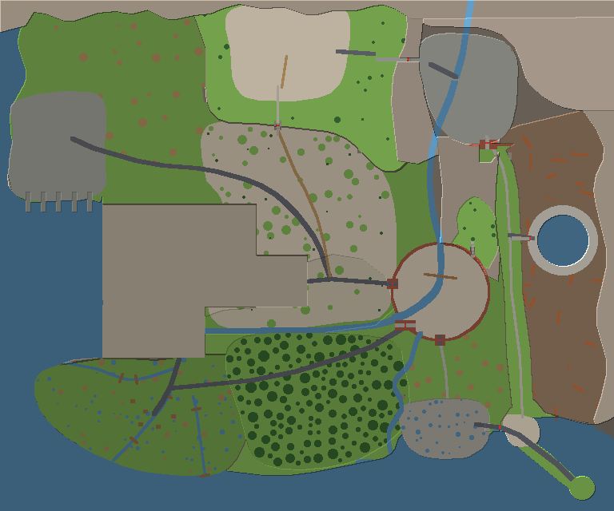

# Handoff: the Hinterland is drawn; next, the walk

Written 2026-11-20. Build order step 4 of `docs/superpowers/specs/2026-11-19-hinterland-atlas-design.md` is done: the overworld beyond the Cordon is the Hinterland, one land plan cut into land squares, with every ward sealed except at its gates and every ward blocked out round its town, Site, outpost and crossings. Plans: `docs/superpowers/plans/2026-11-19-client-scenery-and-land-editor.md` and `docs/superpowers/plans/2026-11-19-draw-the-hinterland.md`.

The picture is `node scripts/landPicture.ts hinterland <png>` with the grid hidden (add `--grid` or `--wards` to check squares and ward shapes).

## What landed (pushed to main)

**Plans.** `d5cc8fd` client scenery and the editor's land layer; `2ede2d7` drawing the Hinterland.

**Scenery and the editor's land layer.**

- `a06ad0d` A level with land gets a scene layout that draws the land around its districts.
- `40e00d6` A district's footprint and an area's goal come from the tiles the district owns.
- `261ffd0` Land plans load as content, and level recipes ask for them by id.
- `b7f8b90` `changedSquares` finds the squares a land edit changed; foreign anchors are keyed by the land they were found on.
- `441a160` Chunks are built from the scene, so land around and past a level's districts is drawn.
- `ab9eb21` Land no district owns is the outside at district edges, and wall lights mount on their own district's side.
- `1e1c82e` The maps paint the whole land and label districts by the tiles they own.
- Task 8 of the scenery plan landed inside `a312f38` (a UI audit commit from another session).
- `cc2f59f` The editor document holds land plans and re-cuts the squares a land edit changes.
- `5f105ed` Pure land plan edits, each checked by drawing the plan.
- `53adcc6` Draw, select and reshape land plan steps on the editor's plan.
- `13cc7c5` Save land plans from the editor, refusing a plan that breaks a square cut from it.
- `6e6f4d2` Docs and the handoff to drawing the Hinterland.

**The Hinterland.**

- `313657f` Safety and areas come from a per-tile mask built once per level instance.
- `b777ebd` The land is seeded from the approved map (`scripts/seedHinterland.ts`).
- `25bedad` The land is cut into land squares and placed on the overworld in place of the block-out (`scripts/cutHinterland.ts`).
- `6897d05` The editor saves a land square's layout by building it on the land plan.
- `c1f35ba` Old Shipyards, `ecb42d8` Tidemarsh, `75d388d` the Heights, `ab8e61d` Old Town, `ab46e25` Ironside, `2f03e6d` the Drowned Quarter, `60aa7b6` the Lantern and `d304763` the Blight are blocked out.
- `dfe3feb` The landmarks stand as focal set-pieces.
- This commit: docs and this handoff.

The overworld has 141 districts: the Low Ward's nine blueprint squares and 132 land squares.

## What each ward got

| Ward | Squares | Tiers | What was built |
| - | - | - | - |
| Old Shipyards | 36 | 14–15 | The yards on the north-west coast over four squares (Slipway Row, Shipwrights' Hard, Graving Docks, Dry Dock Four). Site Caisson at Dry Dock Four under the Goliath crane. Forward Post Four in Gatehouse Yard at the crossroads. The Incline foot with its winding gear. The moor and the overgrown valley as wild land. |
| Tidemarsh | 26 | 16–17 | Stiltholm, a stilt village on boardwalks with its tide bell. The Brinehouse on piles in the delta. Tide Station by the sluice with its tide gauge. The causeway end. The delta marshes and the Great Wood. |
| the Heights | 14 | 18–19 | Uptown on the ridge over three squares: North Parade with the ridge beacon, Crescent Walk with its screen and Uptown with the Exchange clock. The Spire. Upper Station with the Incline sheave. The viaduct end in the Railway Cutting. Nothing is built within six tiles of the ridge drop, so the view stays open. |
| Old Town | 9 | 20–21 | A walled city astride the river: Westgate with the Hostel and the gate clock, Cathedral Close with the cathedral, Ossuary stair and holding block, Wallside's river tower, East Wall's market and town pump, Floodgate Street's winding gear, Moat Bank's tannery and Water Gate's wharf crane. At least three bridges. Gallows Hill outside the east wall, with the gibbet and the gallows. |
| Ironside | 8 | 22–23 | Railhead with Shift House and the coaling gantry. The Bellows compound (station, turbine hall, control block and cooling towers). Furnace Row's three stacks at 2.5× scale, lit at the top. The Falls with its penstock gate and intake house. Two river bridges. |
| Drowned Quarter | 9 | 24–25 | Half-sunk streets with flooded lanes and boardwalks. Site Fathom (yard, headhouse, holding block, bell derrick and diving bell). The Roost outpost with the drowned belfry, and the seawall lodge and gate. The wild moors have rises and cover. |
| the Lantern | 15 | 26–27 | The keepers' hamlet with Keepers' Post and the fog bell. The lit lighthouse precinct, headhouse and lens store at the tip of the spit. The seawall path's steps house. The Blight road on its ledge, with at least six waystations and four milestones. The rim gate lodge on Rim Road. |
| the Blight | 15 | 28 | Wild land gone wrong round the crater lake, all `alien`: broken pylons, wrecks, dead stands, glassy pools and rises, with the crater rim kept clear. Rim Camp just inside the rim gate (post, stores, bunks and searchlights on the lake). |

Every town, Site and outpost square names its landmark room in `furnish.landmarks`, and the landmark stands there as a `focal` set-piece (`HINTERLAND_LANDMARK_PREFABS` in `content/seed/hinterland.ts`). The test fixture world knows the shipped landmark objects (`SHIPPED_LANDMARK_OBJECTS`), so the prefab checks run unweakened.

## Checks and numbers

- `npm run typecheck` is clean and `npm test` passes (962 tests).
- `npm run bench:tick` on the 768 × 640 overworld, with capacity left at 300:

  | Players | Mean | p95 | Max | Budget at p95 | Per player |
  | - | - | - | - | - | - |
  | 100 | 1.6 ms | 2.3 ms | 3.0 ms | 1% | ~1.1 KB/s |
  | 300 | 7.0 ms | 10.9 ms | 14.3 ms | 4% | ~2.4 KB/s |
  | 600 | 23.7 ms | 33.5 ms | 46.7 ms | 11% | ~4.5 KB/s |
  | 1000 | 43.9 ms | 55.9 ms | 77.6 ms | 19% | ~7.2 KB/s |

  The tick has room. Raising `capacity` is a separate decision.

## Open items

- **The land tools were never checked in a running editor.** The land layer (L), vertex editing and land saves are covered by unit tests only. Every ward was blocked out by editing layouts and `hinterland.json` directly.
- **The live walk (build order step 5) has not happened.** Nobody has walked the Hinterland in a game. It includes the terrain checks the spec lists: climbing a ramp, the camera following, clicking a cliff top, creatures pathing round a plateau, and ranged attacks across a cliff rim.
- **Nothing grants `ward-open:the-blight`.** Last Light's reward is meant to grant it (atlas spec, Story changes), but the quest is not written. Until then the crater rim gate is closed in play.
- **The Hollow level is reserved.** No level may take the id `the-hollow` (a test holds this). How the finale enters it is the finale's plan to decide.
- **Sliver squares are barely dressed.** `ash-margin` and `blight-shore` carry little more than the placeholder lamp, burn barrel and barricade.
- **The fence-beside-land seam needs a visual check.** Where a blueprint square's fence edge stands beside land (the Low Ward's outer edges), nobody has looked at the seam in 3D.
- Bellows' boiler stack and the older Site landmarks (gantry crane, windpump, Spire, bell tower, cooling towers, diving bell, lighthouse) are still plain objects. Their squares do not name them as landmarks.

## Next

1. **Step 5, the walk.** Run `npm run dev`, open http://localhost:5173 and walk from Terminus Square through the Cordon and every ward with the gates opened (the `ward-open:*` flags set). Do the terrain checks above. Then look at the seams, the sliver squares and the fence-beside-land edges, and open the land layer in the editor (`/editor.html?land=hinterland`) to try the land tools on a real plan.
2. **Step 6, the far view,** with its own plan. It draws low-detail land and landmark silhouettes beyond the built chunks, so the sightlines in the atlas spec work.

## How to work

- `hinterland.json` and every land square layout are hand-owned. **Never re-run `scripts/cutHinterland.ts --force`.** Edit the land in the editor's land layer, or edit the JSON directly in `printLandPlan`'s form, and keep `packages/shared/test/hinterland.test.ts` green.
- A layout patch over rock makes it walkable, which can unseal a ward or leave unreachable pockets. Keep patches inside the ward's walkable land, or lay `boards` over water for bridges.
- Stage files by name. `.claude/settings.json`, `.claude/launch.json`, `scripts/_ids.ts`, `scripts/_ascii.ts` and `docs/handoffs/2026-11-18-ui-audit.md` belong to other sessions.
